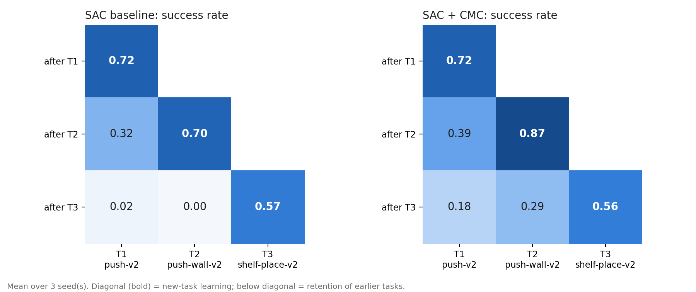
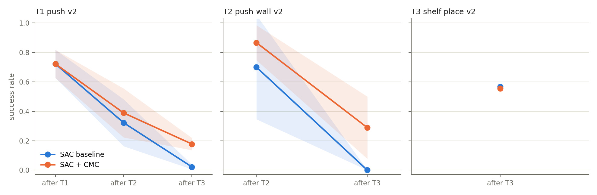
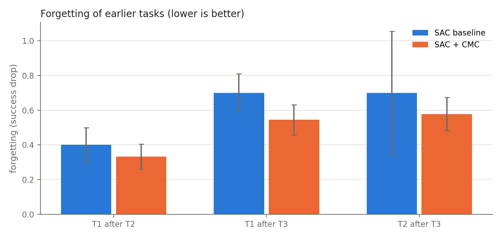
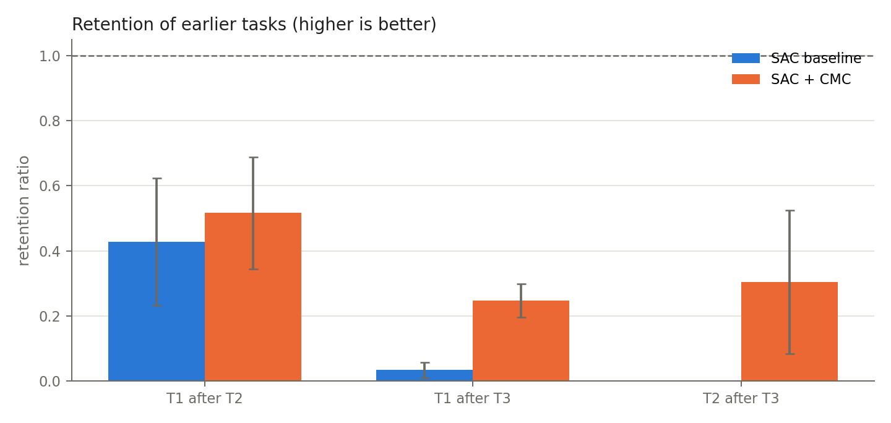
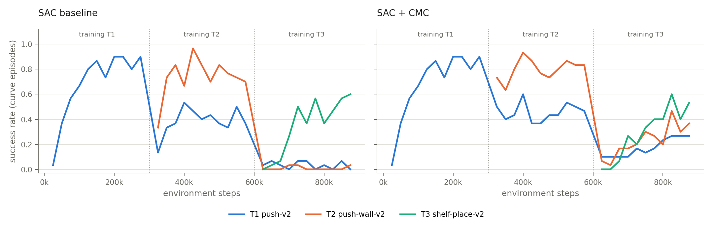

# Continual learning: SAC baseline vs SAC + CMC

Tasks: T1 push-v2 → T2 push-wall-v2 → T3 shelf-place-v2  
Paired seeds: [1, 2, 3] (values are mean ± std over seeds)

Evaluation protocol identical in both arms (same tasks, budget, episode count and evaluation episodes).

## ⚠ Tasks not reliably learned

A task that was never reliably learned cannot meaningfully be forgotten; read its numbers with care.

- SAC baseline: T1 reached only 0.72 success right after training (< 0.8).
- SAC baseline: T2 reached only 0.70 success right after training (< 0.8).
- SAC baseline: T3 reached only 0.57 success right after training (< 0.8).
- SAC + CMC: T1 reached only 0.72 success right after training (< 0.8).
- SAC + CMC: T3 reached only 0.56 success right after training (< 0.8).

## Success rate (primary)

### SAC baseline

| after stage | T1 push-v2 | T2 push-wall-v2 | T3 shelf-place-v2 |
|---|---|---|---|
| after T1 | **0.72 ± 0.10** | – | – |
| after T2 | 0.32 ± 0.16 | **0.70 ± 0.35** | – |
| after T3 | 0.02 ± 0.02 | 0.00 ± 0.00 | **0.57 ± 0.10** |

### SAC + CMC

| after stage | T1 push-v2 | T2 push-wall-v2 | T3 shelf-place-v2 |
|---|---|---|---|
| after T1 | **0.72 ± 0.10** | – | – |
| after T2 | 0.39 ± 0.17 | **0.87 ± 0.12** | – |
| after T3 | 0.18 ± 0.04 | 0.29 ± 0.21 | **0.56 ± 0.28** |

### Continual-learning metrics (success)

| group | metric | SAC baseline | SAC + CMC | CMC − baseline |
|---|---|---|---|---|
| New-task learning | T1 after T1 | 0.72 ± 0.10 | 0.72 ± 0.10 | 0.00 ± 0.00 |
| New-task learning | T2 after T2 | 0.70 ± 0.35 | 0.87 ± 0.12 | 0.17 ± 0.24 |
| New-task learning | T3 after T3 | 0.57 ± 0.10 | 0.56 ± 0.28 | -0.01 ± 0.18 |
| Retained value | T1 after T2 | 0.32 ± 0.16 | 0.39 ± 0.17 | 0.07 ± 0.08 |
| Retained value | T1 after T3 | 0.02 ± 0.02 | 0.18 ± 0.04 | 0.16 ± 0.04 |
| Retained value | T2 after T3 | 0.00 ± 0.00 | 0.29 ± 0.21 | 0.29 ± 0.21 |
| Forgetting | T1: after T1 − after T2 | 0.40 ± 0.10 | 0.33 ± 0.07 | -0.07 ± 0.08 |
| Forgetting | T1: after T1 − after T3 | 0.70 ± 0.11 | 0.54 ± 0.09 | -0.16 ± 0.04 |
| Forgetting | T2: after T2 − after T3 | 0.70 ± 0.35 | 0.58 ± 0.10 | -0.12 ± 0.44 |
| Summary | Average final (all tasks after T3) | 0.20 ± 0.03 | 0.34 ± 0.17 | 0.14 ± 0.14 |
| Summary | Average forgetting (T1, T2 after T3) | 0.70 ± 0.22 | 0.56 ± 0.02 | -0.14 ± 0.24 |

Forgetting > 0 means success dropped after later training; CMC − baseline < 0 for forgetting means CMC forgot less.

## Return (secondary)

### SAC baseline

| after stage | T1 push-v2 | T2 push-wall-v2 | T3 shelf-place-v2 |
|---|---|---|---|
| after T1 | **2931 ± 272** | – | – |
| after T2 | 1306 ± 502 | **2940 ± 1334** | – |
| after T3 | 169 ± 126 | 43 ± 15 | **1716 ± 338** |

### SAC + CMC

| after stage | T1 push-v2 | T2 push-wall-v2 | T3 shelf-place-v2 |
|---|---|---|---|
| after T1 | **2931 ± 272** | – | – |
| after T2 | 1366 ± 165 | **3655 ± 173** | – |
| after T3 | 745 ± 223 | 1019 ± 692 | **1423 ± 772** |

### Continual-learning metrics (return)

| group | metric | SAC baseline | SAC + CMC | CMC − baseline |
|---|---|---|---|---|
| New-task learning | T1 after T1 | 2931 ± 272 | 2931 ± 272 | 0 ± 0 |
| New-task learning | T2 after T2 | 2940 ± 1334 | 3655 ± 173 | 715 ± 1167 |
| New-task learning | T3 after T3 | 1716 ± 338 | 1423 ± 772 | -293 ± 546 |
| Retained value | T1 after T2 | 1306 ± 502 | 1366 ± 165 | 60 ± 462 |
| Retained value | T1 after T3 | 169 ± 126 | 745 ± 223 | 576 ± 161 |
| Retained value | T2 after T3 | 43 ± 15 | 1019 ± 692 | 976 ± 682 |
| Forgetting | T1: after T1 − after T2 | 1626 ± 357 | 1566 ± 137 | -60 ± 462 |
| Forgetting | T1: after T1 − after T3 | 2762 ± 335 | 2186 ± 265 | -576 ± 161 |
| Forgetting | T2: after T2 − after T3 | 2897 ± 1325 | 2636 ± 532 | -261 ± 1848 |
| Summary | Average final (all tasks after T3) | 643 ± 128 | 1062 ± 533 | 420 ± 406 |
| Summary | Average forgetting (T1, T2 after T3) | 2830 ± 772 | 2411 ± 254 | -418 ± 1005 |

## Figures

