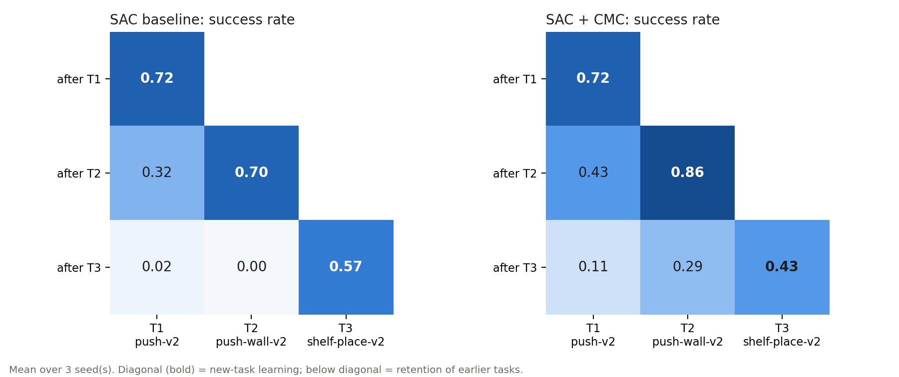
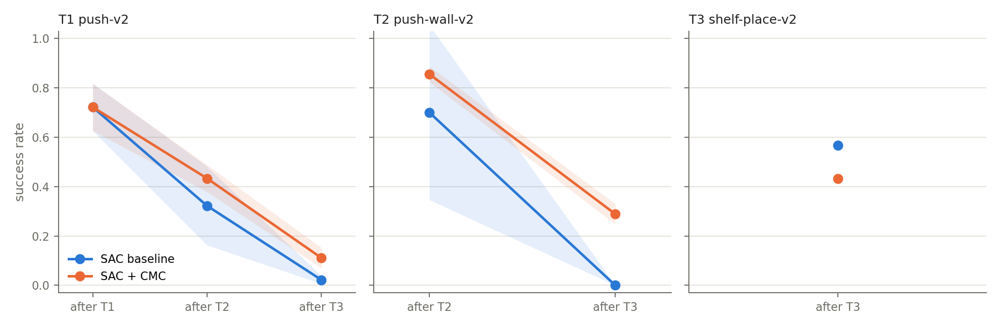
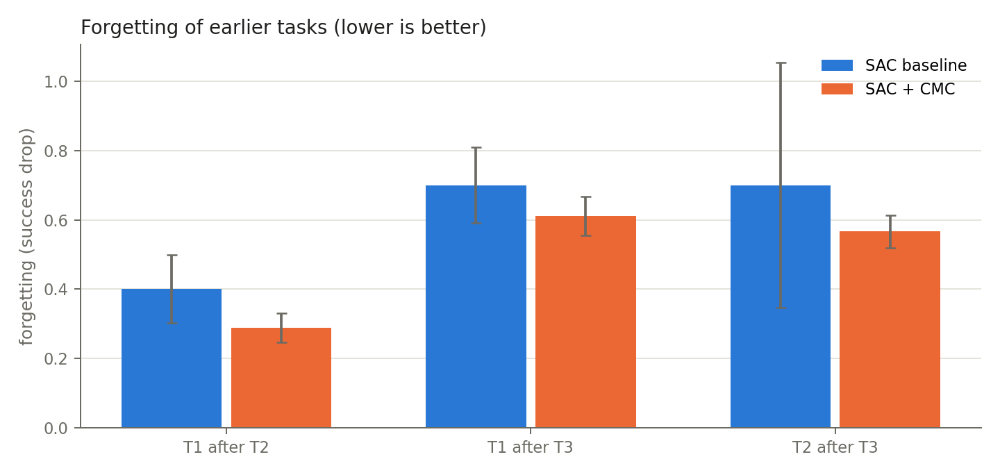
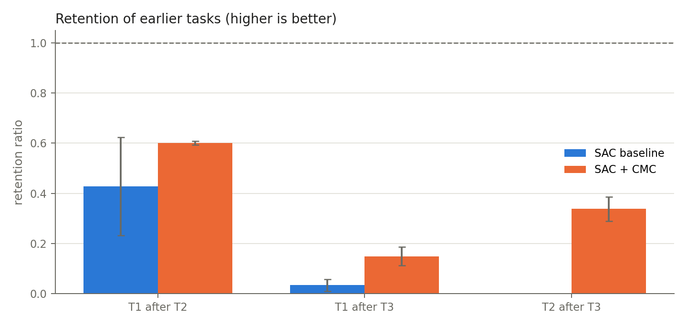
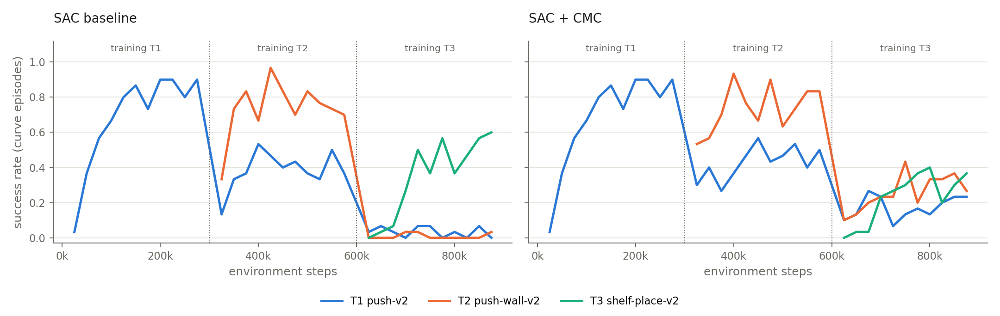

# Continual learning: SAC baseline vs SAC + CMC

Tasks: T1 push-v2 → T2 push-wall-v2 → T3 shelf-place-v2  
Paired seeds: [1, 2, 3] (values are mean ± std over seeds)

Evaluation protocol identical in both arms (same tasks, budget, episode count and evaluation episodes).

## ⚠ Tasks not reliably learned

A task that was never reliably learned cannot meaningfully be forgotten; read its numbers with care.

- SAC baseline: T1 reached only 0.72 success right after training (< 0.8).
- SAC baseline: T2 reached only 0.70 success right after training (< 0.8).
- SAC baseline: T3 reached only 0.57 success right after training (< 0.8).
- SAC + CMC: T1 reached only 0.72 success right after training (< 0.8).
- SAC + CMC: T3 reached only 0.43 success right after training (< 0.8).

## Success rate (primary)

### SAC baseline

| after stage | T1 push-v2 | T2 push-wall-v2 | T3 shelf-place-v2 |
|---|---|---|---|
| after T1 | **0.72 ± 0.10** | – | – |
| after T2 | 0.32 ± 0.16 | **0.70 ± 0.35** | – |
| after T3 | 0.02 ± 0.02 | 0.00 ± 0.00 | **0.57 ± 0.10** |

### SAC + CMC

| after stage | T1 push-v2 | T2 push-wall-v2 | T3 shelf-place-v2 |
|---|---|---|---|
| after T1 | **0.72 ± 0.10** | – | – |
| after T2 | 0.43 ± 0.05 | **0.86 ± 0.03** | – |
| after T3 | 0.11 ± 0.04 | 0.29 ± 0.04 | **0.43 ± 0.10** |

### Continual-learning metrics (success)

| group | metric | SAC baseline | SAC + CMC | CMC − baseline |
|---|---|---|---|---|
| New-task learning | T1 after T1 | 0.72 ± 0.10 | 0.72 ± 0.10 | 0.00 ± 0.00 |
| New-task learning | T2 after T2 | 0.70 ± 0.35 | 0.86 ± 0.03 | 0.16 ± 0.34 |
| New-task learning | T3 after T3 | 0.57 ± 0.10 | 0.43 ± 0.10 | -0.13 ± 0.00 |
| Retained value | T1 after T2 | 0.32 ± 0.16 | 0.43 ± 0.05 | 0.11 ± 0.12 |
| Retained value | T1 after T3 | 0.02 ± 0.02 | 0.11 ± 0.04 | 0.09 ± 0.06 |
| Retained value | T2 after T3 | 0.00 ± 0.00 | 0.29 ± 0.04 | 0.29 ± 0.04 |
| Forgetting | T1: after T1 − after T2 | 0.40 ± 0.10 | 0.29 ± 0.04 | -0.11 ± 0.12 |
| Forgetting | T1: after T1 − after T3 | 0.70 ± 0.11 | 0.61 ± 0.06 | -0.09 ± 0.06 |
| Forgetting | T2: after T2 − after T3 | 0.70 ± 0.35 | 0.57 ± 0.05 | -0.13 ± 0.31 |
| Summary | Average final (all tasks after T3) | 0.20 ± 0.03 | 0.28 ± 0.03 | 0.08 ± 0.02 |
| Summary | Average forgetting (T1, T2 after T3) | 0.70 ± 0.22 | 0.59 ± 0.05 | -0.11 ± 0.17 |

Forgetting > 0 means success dropped after later training; CMC − baseline < 0 for forgetting means CMC forgot less.

## Return (secondary)

### SAC baseline

| after stage | T1 push-v2 | T2 push-wall-v2 | T3 shelf-place-v2 |
|---|---|---|---|
| after T1 | **2931 ± 272** | – | – |
| after T2 | 1306 ± 502 | **2940 ± 1334** | – |
| after T3 | 169 ± 126 | 43 ± 15 | **1716 ± 338** |

### SAC + CMC

| after stage | T1 push-v2 | T2 push-wall-v2 | T3 shelf-place-v2 |
|---|---|---|---|
| after T1 | **2931 ± 272** | – | – |
| after T2 | 1593 ± 501 | **3486 ± 622** | – |
| after T3 | 494 ± 116 | 1056 ± 49 | **1358 ± 348** |

### Continual-learning metrics (return)

| group | metric | SAC baseline | SAC + CMC | CMC − baseline |
|---|---|---|---|---|
| New-task learning | T1 after T1 | 2931 ± 272 | 2931 ± 272 | 0 ± 0 |
| New-task learning | T2 after T2 | 2940 ± 1334 | 3486 ± 622 | 545 ± 721 |
| New-task learning | T3 after T3 | 1716 ± 338 | 1358 ± 348 | -358 ± 181 |
| Retained value | T1 after T2 | 1306 ± 502 | 1593 ± 501 | 288 ± 413 |
| Retained value | T1 after T3 | 169 ± 126 | 494 ± 116 | 325 ± 234 |
| Retained value | T2 after T3 | 43 ± 15 | 1056 ± 49 | 1013 ± 40 |
| Forgetting | T1: after T1 − after T2 | 1626 ± 357 | 1338 ± 231 | -288 ± 413 |
| Forgetting | T1: after T1 − after T3 | 2762 ± 335 | 2438 ± 200 | -325 ± 234 |
| Forgetting | T2: after T2 − after T3 | 2897 ± 1325 | 2430 ± 629 | -467 ± 699 |
| Summary | Average final (all tasks after T3) | 643 ± 128 | 969 ± 112 | 327 ± 33 |
| Summary | Average forgetting (T1, T2 after T3) | 2830 ± 772 | 2434 ± 414 | -396 ± 361 |

## Figures

